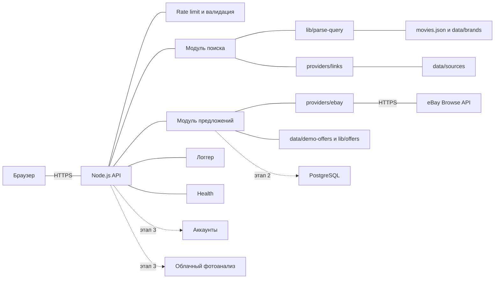
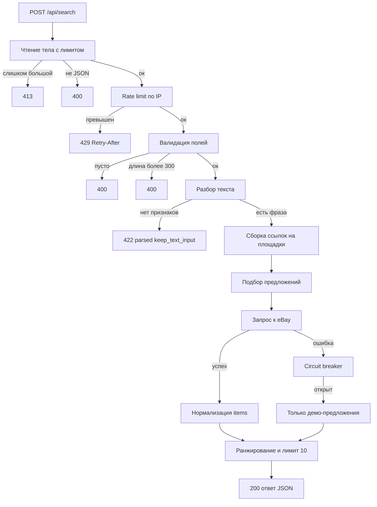

# VishFind — архитектурная спецификация первой production-версии

> **Статус:** утверждённый план разработки V1.
> **Важное условие:** данный документ фиксирует согласованный план и целевую архитектуру. Он **не является** подтверждением того, что production-безопасность уже проверена — это задача этапа реализации и проверки.

Дата согласования: 2026-10-26.
Область: минимальный набор изменений для первого публичного деплоя VishFind (Node.js 18+, без новых npm-зависимостей).

---

## 0. Базовые принципы

1. **Ноль новых npm-зависимостей** — Node.js 18+, стандартная библиотека. Всё ниже реализуемо на чистом Node.
2. **Один процесс, один инстанс** — rate limit и circuit breaker в памяти процесса. Мультиинстансность — на этапе PostgreSQL.
3. **Секреты только в окружении** — в код и репозиторий не попадают; в лог — только в маскированном виде.
4. **Отказ внешнего сервиса не роняет поиск** — eBay недоступен → демо-предложения + прямая честная пометка.
5. **Никакого скрейпинга и цен-фантазий** — только официальные API (eBay Browse) и переходы на площадки.
6. **Фото — только локальная разработка** (Ollama); в production фото-путь отключён по умолчанию.
7. **PostgreSQL, аккаунты, облачный фотоанализ — будущие этапы**, спроектированы как точки расширения, а не как текущий код.

---

## 1. Компоненты

| Компонент | Сейчас | Роль |
|---|---|---|
| **Браузер** | `index.html`, `js/search.js`, `js/theme.js` | Поиск и правка критериев, `?q=`, тёмная тема. Секретов не знает |
| **Node.js API** | `server.js` | HTTP-сервер, маршрутизация, заголовки безопасности, статика, лимиты |
| **Модуль поиска** | `lib/parse-query.js`, `providers/links.js` | Разбор текста правилами → фраза → ссылки на площадки |
| **Модуль предложений** | `lib/offers.js` + `data/demo-offers.json` | Скоринг, бюджет, сортировка; сейчас только честное демо |
| **eBay-провайдер** | `providers/ebay.js` | Официальный Browse API, кэш токена и результатов, ошибки не бросает |
| **Логгер** | — (будет `lib/logger.js`) | JSON-строки, санитизация секретов и PII, уровни |
| **Конфиг** | внутри `server.js` (будет `lib/config.js`) | Хранилище настроек dev/prod |
| **PostgreSQL** | будущее | Каталог, история поисков, позже аккаунты, shared-rate-limit |
| **Аккаунты** | будущее | Сохранённые запросы, вишлист, модерация |
| **Облачный фотоанализ** | будущее | Отдельный сервис; локальная Ollama только для разработки |

---

## 2. Поток запроса

Последовательность и ответственность:

1. **Транспорт** — `readBody` с лимитом: production 64 КБ (фото выключено), development до ~9 МБ (фото через Ollama).
2. **Rate limit** — `lib/rate-limit.js`, скользящее окно в памяти, ключ = IP.
3. **Валидация** — JSON, наличие `query | image | attributes`, длина запроса ≤ 300 символов.
4. **Разбор текста** — `lib/parse-query` с словарями `movies.json`, `data/brands.json`; применение ручных `attributes` (текст пользователя важнее догадок).
5. **Фото (dev)** — `analyze()` → Ollama vision, JSON Schema, честные ошибки; в prod ветка недостижима при `AI_ENABLED=false`.
6. **Поиск в каталоге** — демо-каталог через `offersApi.findOffers` (score ≥ 1, бюджет, in_stock).
7. **Вызов eBay** — только если настроены ключи; circuit breaker; кэш результатов 10 минут; таймауты 8 с/10 с.
8. **Нормализация** — `normalizeItem` в `providers/ebay.js`: `category/color/size/brand = null` без угадывания, `is_demo: false`.
9. **Ранжирование** — eBay-предложения впереди, затем демо; всего до 10 позиций.
10. **Ответ** — `parsed`, `sources`, `offers` (с `is_demo`, `ebay_error`), `photo`, `providers`, `note`.

---

## 3. Обработка ошибок

| Ситуация | HTTP | Что возвращаем клиенту | Что делаем внутри |
|---|---|---|---|
| Невалидный JSON / большое тело | 400 / 413 | `{error}` | Лог уровня `warn` без тела запроса |
| Превышен rate limit | 429 | `{error, retry_after_sec}` + заголовок `Retry-After` | Лог `warn` с маскированным IP |
| Нет признаков в тексте | 422 | `{error, parsed, keep_text_input}` | Не ошибка — обычный UX-путь |
| **eBay недоступен** | 200 с фолбэком | `offers.ebay_error` = дружелюбное «eBay временно недоступен, показаны демо-предложения» | Полный код ошибки — только в лог; счётчик circuit breaker |
| Таймаут eBay (8с/10с) | см. выше | То же | `AbortController`; константы в `providers/ebay.js` |
| Пустой каталог / нет совпадений | 200 | `offers.items: []` + `note`, `sources` работают | Не паника, не выдуманные товары |
| Ollama (dev): таймаут / нет одежды | 502 | Честное сообщение, `photo_used: false` | Никогда не подменяем провал успехом |
| Будущая ошибка БД | 500 | Общее «Внутренняя ошибка сервера» | Деталь в лог, `health` показывает degraded |
| Неклассифицированное исключение | 500 | Общее, `res.headersSent` не сломан | `logger.error` со стеком |
| Статика: служебные пути | 403 | «Forbidden» | `PRIVATE_TOP` уже закрывает `server.js`, `data/`, `lib/`, `.env`, `providers/` и т.д. |

**Circuit breaker для eBay** (в `providers/ebay.js`): 3 последовательные ошибки → окно «открыт» на 60 с (настраивается через env), запросы к eBay не выполняются, отдаётся фолбэк; успех сбрасывает счётчик.

---

## 4. Логирование

Модуль `lib/logger.js`, формат — JSON-строки в stdout (`{ts, level, msg, ...meta}`), чтобы платформа могла собирать их как структурированные.

**Какие события логируем:**
- запуск/остановка (env, port, состояние провайдеров — без значений ключей);
- HTTP-запросы: `method`, `path`, `status`, длительность, маскированный IP (dev) — уровень `info`/`debug`;
- rate-limit срабатывания (маскированный IP) — `warn`;
- недоступность/ошибки eBay: код, статус, состояние circuit breaker — `warn`/`error`;
- ошибки фотоанализа (dev): тип ошибки, pipeline — `warn`;
- невалидные запросы — `warn`;
- смена состояния health/degraded — `warn`;
- непойманные исключения — `error` со стеком.

**Что никогда не логируем:**
- секреты: `client_secret`, `access_token`, `client_id`, `api_key`, `authorization`, cookies, пароли (маскируются по имени поля рекурсивно);
- base64 фото и тела запросов (в т.ч. `data:image/...`);
- raw-запросы пользователя по умолчанию; при `LOG_LEVEL=debug` — только усечённый фрагмент до 120 символов с маскировкой email/телефонов;
- полные IP-адреса (в prod IP не пишем вовсе или только первые октеты);
- ответы сторонних API целиком (только код статуса и усечённый фрагмент).

**Уровни:** `error` → `warn` → `info` → `debug`. По умолчанию: dev `debug`, prod `warn` (меньше шума, ошибки видны).

**Как логи помогают в проде:** по `ebay circuit open` видно деградацию, по 429 — атаку/некорректный клиент, по 500 со стеком — баг без участия чувствительных данных, по запросу `/api/health` от платформы — жизнеспособность инстанса.

---

## 5. Rate limit

| Параметр | Значение по умолчанию | Назначение |
|---|---|---|
| `RATE_LIMIT_MAX` | 20 | максимум запросов за окно |
| `RATE_LIMIT_WINDOW_SEC` | 60 | окно, секунды |
| Ключ | IP | в памяти процесса |

- **Разумно для первого запуска:** 20/мин на IP для `/api/search` и `/api/find`; `/api/health` и статика не лимитируются (дёшево). Этого достаточно для MVP и защиты бесплатного хостинга.
- **Как считаем:** скользящее окно: `Map<ip, timestamps>`, отбрасывание записей старше окна при каждом запросе, память ~1 запись на запрос.
- **IP и прокси:** заголовок `X-Forwarded-For` используется **только** при `TRUST_PROXY=true` (в prod за платформенным прокси); иначе берём `socket.remoteAddress`, чтобы клиент не обходил лимит подделкой заголовка.
- **При превышении:** `429` + заголовок `Retry-After` (сек) + `{error, retry_after_sec}`.
- **Ограничение:** счётчик в памяти одного процесса; на этапе PostgreSQL/нескольких инстансов — общий счётчик (Redis/БД). Для первого деплоя одного инстанса достаточно.

---

## 6. `/api/health`

**Что проверяем** (дёшево, без внешних вызовов):
- процесс жив → всегда `200`;
- `ok: true`, `name`, `version` (из `package.json`), `env`, `uptime_sec`, `timestamp`;
- `ai_enabled`, веб-поиск (`tavily|ollama|null`);
- `providers` состояния;
- `ebay`: `configured`, `circuit_open`, последний статус/время (без деталей ошибки);
- `message` — человекочитаемая сводка.

**Что не проверяем:** не дёргаем Ollama/eBay на каждом health (health обязан быть мгновенным и не ронять мониторинг). Состояние считается из кэша/счётчиков. Не раскрываем секреты: в ответе нет ни одного значения ключей, нет полных IP, нет `client_secret`.

**Принцип:** деградация eBay не делает health «красным» систематически — сервис работает на фолбэке; на этапе БД появится отдельный признак БД/readiness.

---

## 7. Конфигурация

`lib/config.js` — единая точка чтения env с безопасными дефолтами, разделение по `NODE_ENV`.

| Переменная | Умолчание dev | Умолчание prod | Обязательная | Назначение |
|---|---|---|---|---|
| `NODE_ENV` | `development` | `production` | — | включает/выключает ветки |
| `PORT` | `3000` | из платформы | — | порт HTTP |
| `HOST` | `0.0.0.0` | `0.0.0.0` | — | адрес bind |
| `AI_ENABLED` | `true` | **`false`** | — | фото-путь через Ollama; в prod выключен |
| `TRUST_PROXY` | `false` | `true` | — | доверять `X-Forwarded-For` |
| `LOG_LEVEL` | `debug` | `warn` | — | уровень логов |
| `RATE_LIMIT_MAX` / `RATE_LIMIT_WINDOW_SEC` | 20 / 60 | 20 / 60 | — | лимиты |
| `EBAY_CLIENT_ID` / `EBAY_CLIENT_SECRET` | пусто | пусто | опционально | без ключей — только демо-предложения |
| `EBAY_MARKETPLACE` | `EBAY_US` | `EBAY_US` | — | площадка eBay |
| `EBAY_CIRCUIT_THRESHOLD` / `EBAY_CIRCUIT_COOLDOWN_SEC` | 3 / 60 | 3 / 60 | — | circuit breaker |
| `OLLAMA_URL`, `OLLAMA_MODEL`, `PHOTO_PIPELINE` и др. | локальные | не нужны | только при AI | dev-фотоанализ |

**Безопасные дефолты:** в prod `AI_ENABLED=false`, `LOG_LEVEL=warn`, `TRUST_PROXY=true`, лимит тела 64 КБ — даже если платформа задала минимум переменных, сервис работает, не требует ключей и не светит данных.

---

## 8. План развития

| Версия | Состав | Критерий готовности |
|---|---|---|
| **V1 — текущая + продакшен-хардненинг** | config, логгер, rate limit, TRUST_PROXY, health, circuit breaker, README, тесты | Публичный деплой одного инстанса |
| **V2 — PostgreSQL + аккаунты** | БД каталога и истории, общий rate limit, сохранённые запросы/вишлист | Несколько инстансов, авторизация |
| **V3 — облачный фотоанализ** | Отдельный сервис распознавания по API; локальная Ollama остаётся только для dev | Фото в проде с приватностью |
| **V4 — партнёрские каталоги** | Официальные API площадок (eBay Browse уже есть), реальные цены | Партнёрские соглашения, без скрейпинга |

---

## Итог: минимум для первого деплоя / не менять сейчас / риски

**Минимальный набор изменений:**
1. `lib/config.js` — новый: настройки dev/prod.
2. `lib/logger.js` — новый: санитизированное логирование.
3. `lib/rate-limit.js` — параметры из конфига + `Retry-After`.
4. `providers/ebay.js` — circuit breaker + `status()`.
5. `server.js` — подключение config/logger, `TRUST_PROXY`, обогащённый `/api/health`, дружелюбные ошибки eBay.
6. `.env.example` — секции Development/Production.
7. `README.md` — раздел «Production deployment».
8. Тесты: `test/logger.test.js` (новый), правки `test/ebay.test.js`.

**Что не менять сейчас:** фронтенд, парсер текста, демо-каталог и скоринг, `providers/links` и `data/sources.json`, legacy `/api/find` (оставить выключенным), не вводить PostgreSQL, аккаунты и новые зависимости, не коммитить и не публиковать `.env`.

**Оставшиеся риски (осознанные):**
- rate limit в памяти — только один инстанс (на старте нормально);
- корректность IP зависит от `TRUST_PROXY` и платформенного прокси;
- стабильность ключей/квот eBay — без ключей сервис деградирует на демо, но не падает;
- смешение реальных и демо-предложений в выдаче — честно помечено `is_demo` и `note`;
- бесплатные хостинги (Render Free) засыпают после простоя и могут быть недоступны с части провайдеров РФ;
- TLS, домен, резервные копии окружения — ответственность платформы/владельца;
- в будущем — приватность фото в облачном анализе потребует отдельного решения (V3).

---

## Приложение. Дополнительные ограничения реализации V1

1. Не изменять существующую архитектуру фронтенда, парсер, демо-каталог, скоринг и генерацию ссылок без технической необходимости.
2. Не добавлять npm-зависимости.
3. Не внедрять PostgreSQL, аккаунты или облачный фотоанализ.
4. Не помещать секреты в код и не коммитить `.env`.
5. Сохранить отказоустойчивость поиска при недоступности eBay (фолбэк на демо-предложения).
6. Не включать фотоанализ в production по умолчанию (`AI_ENABLED=false`).
7. Не утверждать, что тесты или проверки пройдены, если они фактически не запускались.
